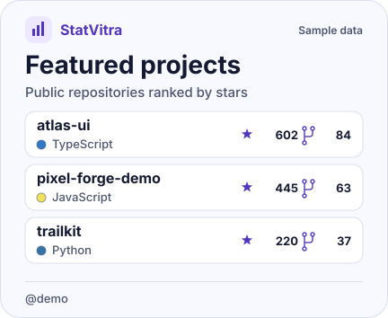
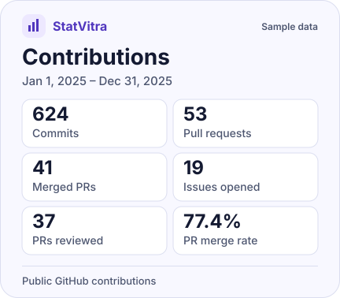
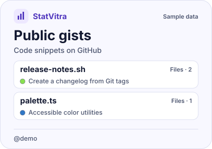
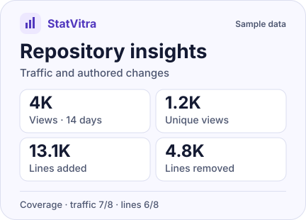
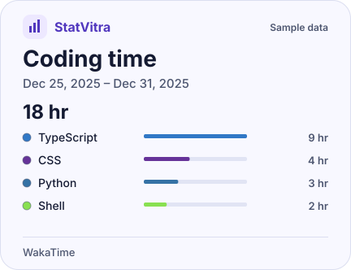

# 📊 StatVitra

Customizable, theme-aware GitHub profile cards generated from public data. Choose which cards to show, where to place them, and whether to animate them. GitHub Actions saves the generated images in your profile repository.

[](https://github.com/alexbritodev/statvitra/actions/workflows/ci.yml)

<picture>
  <source media="(prefers-reduced-motion: no-preference) and (prefers-color-scheme: dark)" srcset="./examples/demo/en/overview-dark-motion.svg">
  <source media="(prefers-reduced-motion: no-preference) and (prefers-color-scheme: light)" srcset="./examples/demo/en/overview-light-motion.svg">
  <source media="(prefers-color-scheme: dark)" srcset="./examples/demo/en/overview-dark.svg">
  
</picture>
<picture>
  <source media="(prefers-reduced-motion: no-preference) and (prefers-color-scheme: dark)" srcset="./examples/demo/en/languages-dark-motion.svg">
  <source media="(prefers-reduced-motion: no-preference) and (prefers-color-scheme: light)" srcset="./examples/demo/en/languages-light-motion.svg">
  <source media="(prefers-color-scheme: dark)" srcset="./examples/demo/en/languages-dark.svg">
  
</picture>

<picture>
  <source media="(prefers-reduced-motion: no-preference) and (prefers-color-scheme: dark)" srcset="./examples/demo/en/projects-dark-motion.svg">
  <source media="(prefers-reduced-motion: no-preference) and (prefers-color-scheme: light)" srcset="./examples/demo/en/projects-light-motion.svg">
  <source media="(prefers-color-scheme: dark)" srcset="./examples/demo/en/projects-dark.svg">
  
</picture>
<picture>
  <source media="(prefers-color-scheme: dark)" srcset="./examples/demo/en/activity-dark.svg">
  
</picture>

[Sample report in English](examples/demo/en/REPORT.md) · [Relatório de exemplo em português](examples/demo/pt-BR/REPORT.md)

<details>
<summary>Preview contributions, gists, repository insights and coding time</summary>

<picture>
  <source media="(prefers-color-scheme: dark)" srcset="./examples/demo/en/contributions-dark.svg">
  
</picture>
<picture>
  <source media="(prefers-color-scheme: dark)" srcset="./examples/demo/en/gists-dark.svg">
  
</picture>

<picture>
  <source media="(prefers-color-scheme: dark)" srcset="./examples/demo/en/insights-dark.svg">
  
</picture>
<picture>
  <source media="(prefers-color-scheme: dark)" srcset="./examples/demo/en/coding-dark.svg">
  
</picture>

</details>

## 🚀 Install on your profile

1. Create or use a **public** repository whose name matches your GitHub username, with a root `README.md`. Clone it locally.
2. Download StatVitra or clone its source. With Node.js 24 or later, run this command from the StatVitra directory.

   ```sh
   node install.mjs ../YOUR-USERNAME
   ```

   The argument is the path to your local profile checkout. The command copies the action, configuration and workflow while preserving your README. You can also copy `action.yml`, `LICENSE`, and `src/` into `.github/statvitra/` manually, then copy `statvitra.json` to the repository root and `examples/statvitra-update.yml` to `.github/workflows/statvitra-update.yml`.
3. English is the default. Set `"locale": "pt-BR"` in `statvitra.json` for Brazilian Portuguese. See [Languages](#-languages) for other options. On a personal profile repo, the username defaults to the owner.
4. Commit and push the files to the profile repository's default branch. On GitHub, select **Actions → Update StatVitra cards → Run workflow**, using the default branch.
5. After the first run, open `statvitra-cards/EMBED.md` in **raw** view and copy the entire snippet into the root `README.md` where you want the cards. Include the opening and closing StatVitra comments to let future runs refresh that section automatically. The rest of your README stays as written.

The example updater uses the repository's automatic `GITHUB_TOKEN`. It asks for `contents: write` to commit updated assets and runs daily around 09:23 UTC. GitHub can delay scheduled runs and disables them in public repositories after 60 days without repository activity. A ruleset that requires a PR can block the example updater’s direct push. In that case, use your normal PR workflow to commit the generated files.

## 📈 What the cards measure

| Card | Source and scope |
| --- | --- |
| Overview | Choose repository, fork and profile metrics. The report lists the same metrics in the order you select. |
| Languages | Bytes reported by GitHub Linguist in up to the configured number of eligible repositories, most recently pushed first. Coverage is shown on the card. When there are more than six languages, the first five are shown separately and the rest are grouped as Other. Shares describe source composition. |
| Projects | Up to five public repositories, ranked by stars, then forks, most recent push, and name. The text report links to each project. |
| Activity | Public events returned by GitHub for the last 30 calendar days in UTC, including the current day. GitHub caps the feed at 300 events and may deliver events late. This card measures events from that feed. |
| Contributions | Commits, issues, pull requests, reviews and more over a selectable period. Public contributions are the default. |
| Gists | Public code snippets with language, file count and optional stars and forks. |
| Insights | Page views over 14 days and lines you authored in selected repositories, with coverage shown separately for each source. |
| Coding | Logged coding time and language durations from WakaTime. |

Repository filters affect Overview, Languages and Projects. The profile's follower count and public event feed are independent of those filters. Cards use public data and GitHub Linguist colors, with a fallback for languages without an assigned color.

## ⚙️ Configuration

| Key | Default | Effect |
| --- | --- | --- |
| `username` | Repository owner in Actions | Set the personal GitHub profile login. The action input and CLI option take precedence. |
| `locale` | `en` | A BCP 47 language tag. The action input and CLI option take precedence. |
| `messages` | `{}` | Override text in the cards, embed snippet, and report. |
| `includeArchived` | `false` | Include archived public repositories. |
| `includeForks` | `false` | Include repositories you forked. |
| `excludeRepositories` | `[]` | Case-insensitive names or glob patterns, e.g. `["old-lab", "user/archive-*"]`. |
| `excludeLanguages` | `[]` | Case-insensitive names or glob patterns, e.g. `["HTML", "Jupyter*"]`. |
| `languageRepositoryLimit` | `30` | Analyze 1–100 eligible repositories for the Languages card. Each analyzed repository uses a REST request. |
| `projectCount` | `3` | Show 1–5 projects. |
| `cards` | `["overview", "languages", "projects", "activity"]` | Select and order up to eight cards. Optional cards are `contributions`, `gists`, `insights` and `coding`. |
| `overviewMetrics` | `["repos", "stars", "forks", "followers"]` | Choose and order one to seven metrics for the Overview card. |
| `showReportLink` | `false` | Display a link to the generated text report below the cards. The report file is always generated. |
| `layout` | `stacked` | Use one card per row or choose `columns` to pair cards when there is room. |
| `branding.position` | `hidden` | Choose `hidden`, `top-left`, or `bottom-right`. |
| `branding.link` | `false` | Make cards with visible branding link to StatVitra. |
| `animation` | `none` | Use static cards or choose `fade`, `rise`, or `sweep`. |
| `cardAnimations` | `{}` | Override the animation for individual cards. |
| `exportJson` | `false` | Write card data and eligible public repository details to `statvitra-cards/STATS.json`, including per-repository languages when analyzed. |

## 🎛️ Customize your cards

List up to eight entries under `cards` in the order you want them to appear. With `columns`, cards appear in pairs where GitHub's content area is wide enough and wrap on narrow screens. Keep both marker comments in your README to apply layout, order, language, and link changes on the next run.

```json
{
  "cards": ["overview", "languages", "projects"],
  "layout": "columns",
  "overviewMetrics": ["repos", "stars", "forks", "forksMade", "followers", "following"],
  "branding": { "position": "bottom-right", "link": false },
  "animation": "fade",
  "cardAnimations": { "languages": "rise", "projects": "sweep" }
}
```

**Fade** brings the card content into view, **Rise** moves the content up slightly, and **Sweep** draws an accent line below the subtitle. Each animation plays once when its image loads. Use the generated embed snippet to select the static SVG for visitors who prefer reduced motion. Viewers without SVG animation support display the final static card.

Branding is opt-in. When you enable the link, clicking the card in the GitHub README opens the StatVitra repository.

### Overview metrics

| Key | What it counts |
| --- | --- |
| `repos` | Selected public repositories you own. |
| `stars` | Stars received across those repositories. |
| `forks` | Forks received across those repositories. |
| `forksMade` | Public fork repositories still owned by the profile, including archived forks. `excludeRepositories` applies. |
| `followers` | Followers of the profile. |
| `following` | Accounts the profile follows. |
| `publicGists` | Public gists published by the profile. |

### Contributions and repository insights

- `contributionYear` selects a calendar year in UTC or `"all"` for all available history. The default is the last 365 calendar days.
- `contributionMetrics` selects and orders `commits`, `pullRequests`, `mergedPullRequests`, `issues`, `reviews`, `mergeRate`, `contributedRepos`, `discussions`, `answers` and `activityScore`. The first six are shown by default.
- Commits come from GitHub's default-branch search index. Merge rate is the share of PRs opened in the period that have since been merged. Reviews count distinct reviewed PRs in the period. Answers count discussions created in the period that have an accepted answer by the user. `contributedRepos` uses GitHub's recent repository list on its own time window.
- The optional activity score is a local measure from 0 to 100. It assigns 1 point per commit, 6 per merged PR, 2 per issue and 3 per reviewed PR, then computes `round(100 × points / (points + 300))`.
- `includePrivateContributions: true` includes aggregate counts visible to the supplied token. Use this deliberately. The resulting totals will be published in the card, report and any enabled JSON export.
- `insightRepositoryLimit` selects 1–15 recently pushed, eligible repositories (default 5). Unique visitors are summed per repository. Line counts are GitHub's available per-author contributor data. Pending, inaccessible and oversized samples reduce coverage. An em dash indicates an unavailable value.

### Projects and gists

- `projectSelection: "pinned"` uses the profile's GitHub pins. `featuredRepositories` takes precedence and accepts up to ten public `owner/repository` entries in the desired order. `projectCount` limits the displayed list.
- The `gists` card uses recent public gists or an ordered `featuredGists` list of public IDs. `gistCount` controls how many appear (1–5, default 3). Enable `gistEngagement` to fetch stars and forks with GraphQL.
- `linkFeaturedCards: true` makes a card with exactly one repository or gist link to that item. Branding links take precedence.

### Languages and appearance

| Option | Values |
| --- | --- |
| `languageScope` | `owned` by default, or `owned-and-contributed` to include public repositories from GitHub's recent contribution list. |
| `languageLayout` | `bar`, `compact`, `donut`, `donut-vertical`, or `pie`. |
| `languageCount`, `languageOther` | Show 1–10 entries (default 6). Group the remainder as Other by default. |
| `languageFormat` | `percent`, `bytes`, or `repositories`. The last format counts repository–language occurrences. |
| `languageWeights` | Score = analyzed bytes raised to `bytes` × repository occurrences raised to `repositories`. Default weights are 1 and 0. |
| `theme`, `cardThemes` | Choose `violet`, `ocean`, `forest`, `slate`, or `contrast` globally or by card. Each has light and dark variants. |
| `cardStyle` | Set `radius` (0–32), `border`, `transparent`, `icons`, or `showTitle`. Override `bg`, `panel`, `line`, `text`, `muted` and `accent` with `#RRGGBB` values under `colors.light` and `colors.dark`. |

### Data access for optional cards

GraphQL selections require a GitHub token. For contribution searches in Actions, grant the automatic token `issues: read` and `pull-requests: read`. Public gists can be retrieved anonymously when an installation token lacks gist access, subject to GitHub's public rate limit. If GitHub limits access for a selection, pass a token with access to that data through the action's `token` input or `GH_TOKEN` locally. Repository traffic requires repository administration read access. Run the same configuration again when GitHub is still preparing contributor statistics.

For coding time, set `wakaTimeUser` to a public WakaTime username or supply `WAKATIME_API_KEY` locally. Pass an Actions secret to the `wakatime_key` input for authenticated access. `wakaTimeRange` accepts `last_7_days` (default), `last_30_days`, `last_6_months`, `last_year` and `all_time`. Outputs contain total and language durations, omitting project names and credentials.

## 🌐 Languages

StatVitra includes English (`en`), Brazilian Portuguese (`pt-BR`), Spanish (`es`), and French (`fr`). Regional variants such as `es-MX` and `fr-CA` use the matching language's wording and Node.js regional number formatting. For other tags, the English wording is used until you supply your own messages. Regional number formats depend on the locale data bundled with Node.js.

To generate a fully translated set for another language, set the locale and translate each key in the [English catalog](src/copy.mjs) under `messages` in `statvitra.json`. Keep both placeholders in `scanned`. You can reorder them to suit the language. Repository names and programming language names come from GitHub.

```json
{
  "locale": "ja-JP",
  "messages": {
    "overview": "プロフィール概要",
    "scanned": "{total} 件中 {count} 件の対象リポジトリを分析"
  }
}
```

The example above overrides two labels. To preview a built-in language, run `npm run demo -- --locale fr`. In GitHub Actions, you may also set `locale: fr` under the action step's `with`.

## 🧪 Local use and distribution

```sh
npm test
npm run demo
node src/cli.mjs --user YOUR-USERNAME
```

There are no npm dependencies to install. The CLI writes `statvitra-cards/` under the current directory. For live generation, a local `GH_TOKEN` or `GITHUB_TOKEN` is optional. Unauthenticated calls have a lower REST API rate limit. A failed API fetch leaves the existing SVGs available. If your checkout ignores the output directory, adjust its `.gitignore` before committing generated cards.

Open `examples/demo/index.html` locally to see the responsive preview in English or Brazilian Portuguese. The preview follows your browser's color scheme.

You can use the action from this repository by replacing `uses: ./.github/statvitra` in the example workflow with `uses: alexbritodev/statvitra@FULL_COMMIT_SHA`. Pin a reviewed commit. The action generates files and the consuming workflow decides where to commit them.

## 🤝 Project guides

- [Contributing](CONTRIBUTING.md)
- [Security policy](SECURITY.md)
- [Changelog](CHANGELOG.md)
- [MIT license](LICENSE)

## 👥 Author

- [Alex Brito](https://github.com/alexbritodev)

## 📄 License

This project is licensed under the [MIT License](LICENSE).
