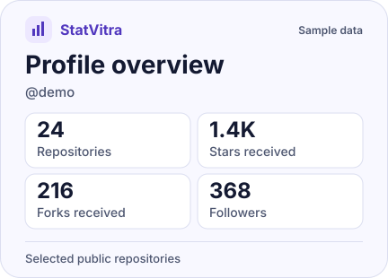
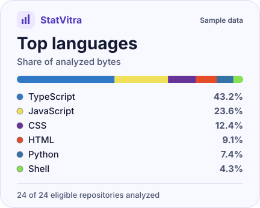
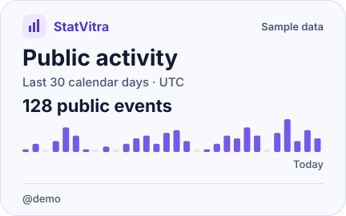

# 📊 StatVitra

Responsive, theme-aware GitHub profile cards generated from public data. Your GitHub Actions workflow saves the cards in your own profile repository. Viewing your README uses the generated images and does not make GitHub API requests.

[](https://github.com/alexbritodev/statvitra/actions/workflows/ci.yml)

<picture>
  <source media="(prefers-color-scheme: dark)" srcset="./examples/demo/en/overview-dark.svg">
  
</picture>
<picture>
  <source media="(prefers-color-scheme: dark)" srcset="./examples/demo/en/languages-dark.svg">
  
</picture>

<picture>
  <source media="(prefers-color-scheme: dark)" srcset="./examples/demo/en/projects-dark.svg">
  
</picture>
<picture>
  <source media="(prefers-color-scheme: dark)" srcset="./examples/demo/en/activity-dark.svg">
  
</picture>

[Sample report in English](examples/demo/en/REPORT.md) · [Relatório de exemplo em português](examples/demo/pt-BR/REPORT.md)

## 🚀 Install on your profile

1. Create or use a **public** repository whose name matches your GitHub username, with a root `README.md`. Clone it locally.
2. Download StatVitra or clone its source. With Node.js 24 or later, run this command from the StatVitra directory.

   ```sh
   node install.mjs ../YOUR-USERNAME
   ```

   The argument is the path to your local profile checkout. The command copies the action, configuration and workflow while preserving your README. You can also copy `action.yml`, `LICENSE`, and `src/` into `.github/statvitra/` manually, then copy `statvitra.json` to the repository root and `examples/statvitra-update.yml` to `.github/workflows/statvitra-update.yml`.
3. English is the default. Set `"locale": "pt-BR"` in `statvitra.json` for Brazilian Portuguese. See [Languages](#-languages) for other options. On a personal profile repo, the username defaults to the owner.
4. Commit and push the files to the profile repository's default branch. On GitHub, select **Actions → Update StatVitra cards → Run workflow**, using the default branch.
5. After the first run, open `statvitra-cards/EMBED.md` in **raw** view and copy its source into the root `README.md` where you want the cards. Update this snippet if you change the selected cards, their order, or their language.

The example updater uses the repository's automatic `GITHUB_TOKEN`. It asks for `contents: write` to commit updated assets and runs daily around 09:23 UTC. GitHub can delay scheduled runs and disables them in public repositories after 60 days without repository activity. A ruleset that requires a PR can block the example updater’s direct push. In that case, use your normal PR workflow to commit the generated files.

## 📈 What the cards measure

| Card | Source and scope |
| --- | --- |
| Overview | Repository count and stars and forks received across the selected public repositories you own. Followers are counted at profile level. |
| Languages | Bytes reported by GitHub Linguist in up to the configured number of eligible repositories, most recently pushed first. Coverage is shown on the card. When there are more than six languages, the first five are shown separately and the rest are grouped as Other. Shares describe source composition. |
| Projects | Up to five public repositories, ranked by stars, then forks, most recent push, and name. The text report links to each project. |
| Activity | Public events returned by GitHub for the last 30 calendar days in UTC, including the current day. GitHub caps the feed at 300 events and may deliver events late. This card measures events from that feed. |

Repository filters affect Overview, Languages and Projects. The profile's follower count and public event feed are independent of those filters. Cards use public data and GitHub Linguist colors, with a fallback for languages without an assigned color.

## ⚙️ Configuration

| Key | Default | Effect |
| --- | --- | --- |
| `username` | Repository owner in Actions | Set the personal GitHub profile login. The action input and CLI option take precedence. |
| `locale` | `en` | A BCP 47 language tag. The action input and CLI option take precedence. |
| `messages` | `{}` | Override text in the cards, embed snippet, and report. |
| `includeArchived` | `false` | Include archived public repositories. |
| `includeForks` | `false` | Include repositories you forked. |
| `excludeRepositories` | `[]` | Case-insensitive exact names, e.g. `["old-lab", "user/profile"]`. |
| `excludeLanguages` | `[]` | Case-insensitive exact language names, e.g. `["HTML"]`. |
| `languageRepositoryLimit` | `30` | Analyze 1–100 eligible repositories for the Languages card. Each analyzed repository uses a REST request. |
| `projectCount` | `3` | Show 1–5 projects. |
| `cards` | All four | Select and order `overview`, `languages`, `projects`, `activity`. |

## 🌐 Languages

StatVitra includes English (`en`), Brazilian Portuguese (`pt-BR`), Spanish (`es`), and French (`fr`). Regional variants such as `es-MX` and `fr-CA` use the matching language's wording and Node.js regional number formatting. For other tags, the English wording is used until you supply your own messages. Regional number formats depend on the locale data bundled with Node.js.

To generate a fully translated set for another language, set the locale and translate each key in the [English catalog](src/copy.mjs) under `messages` in `statvitra.json`. Keep both placeholders in `scanned`. You can reorder them to suit the language. Repository names and programming language names come from GitHub.

```json
{
  "locale": "ja-JP",
  "messages": {
    "overview": "プロフィール概要",
    "scanned": "{total} 件中 {count} 件の対象リポジトリを分析"
  }
}
```

The example above overrides two labels. To preview a built-in language, run `npm run demo -- --locale fr`. In GitHub Actions, you may also set `locale: fr` under the action step's `with`.

## 🧪 Local use and distribution

```sh
npm test
npm run demo
node src/cli.mjs --user YOUR-USERNAME
```

There are no npm dependencies to install. The CLI writes `statvitra-cards/` under the current directory. For live generation, a local `GH_TOKEN` or `GITHUB_TOKEN` is optional. Unauthenticated calls have a lower REST API rate limit. A failed API fetch leaves the existing SVGs available. If your checkout ignores the output directory, adjust its `.gitignore` before committing generated cards.

Open `examples/demo/index.html` locally to see the responsive preview in English or Brazilian Portuguese. The preview follows your browser's color scheme.

You can use the action from this repository by replacing `uses: ./.github/statvitra` in the example workflow with `uses: alexbritodev/statvitra@FULL_COMMIT_SHA`. Pin a reviewed commit. The action generates files and the consuming workflow decides where to commit them.

## 🤝 Project guides

- [Contributing](CONTRIBUTING.md)
- [Security policy](SECURITY.md)
- [Changelog](CHANGELOG.md)
- [MIT license](LICENSE)
